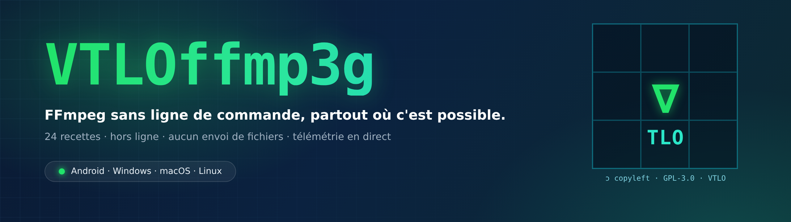
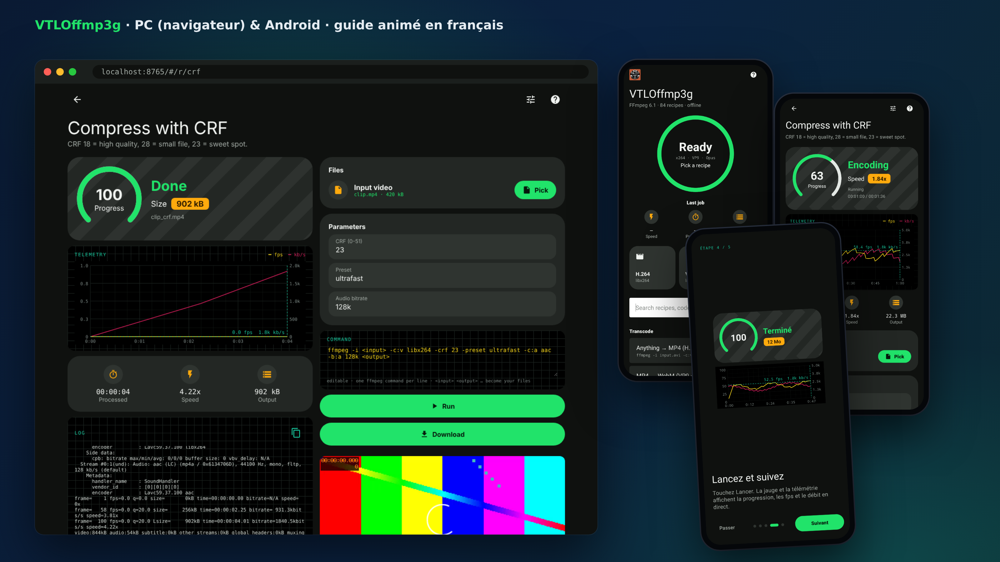

<p align="center">
  
</p>

<p align="center">
  
  
  <br>
  
</p>

# ∇TLO · VTLOffmp3g

> L'édition audio/vidéo sans se casser la tête, pas besoin de taper une seule commande.

VTLOffmp3g est **la façon la plus simple d'utiliser FFmpeg** : Les travaux de montage du quotidien deviennent **84 runners automatisés**, sur plateforme Android comme sur PC. Vous choisissez un fichier, vous réglez deux paramètres, vous lancez : **tout se passe sur votre
appareil, hors ligne, 100% LOCAL - sans envoyer un seul octet sur Internet**. Et pour ceux qui veulent garder la main, la
commande FFmpeg reste visible et modifiable à chaque étape.

<p align="center">
  
</p>

## 📥 Télécharger

| Plateforme | Fichier | Taille |
|---|---|---|
| **Android** 7+ (Smartphones récents, ARM 64 bits) | [`VTLOffmp3g-1.5-arm64-v8a.apk`](downloads/VTLOffmp3g-1.5-arm64-v8a.apk) | 48 Mo |
| **Android** 7+ (Other devices, 32 bits) | [`VTLOffmp3g-1.5-armeabi-v7a.apk`](downloads/VTLOffmp3g-1.5-armeabi-v7a.apk) | 48 Mo |
| **PC** Windows · macOS · Linux (navigateur) | [`VTLOffmp3g-web-1.5.zip`](downloads/VTLOffmp3g-web-1.5.zip) | 11 Mo |

- **Android** : ouvrez l'APK sur le device directement et autorisez l'installation depuis cette source.
- **PC** : décompressez le zip, puis double-cliquez `Lancer-VTLOffmp3g.bat` (Windows) ou lancez `./lancer.sh`
  (macOS / Linux). Le navigateur s'ouvre sur l'application.

Instructions détaillées et empreintes SHA-256 : [`downloads/`](downloads/).

## ✨ Fonctionnalités 

- **84 tested runners** en cinq onglets : *Convertir*, *Audio*, *Montage*, *Effets*, *Analyse*.
- **Montage Standard** : vitesse, ralenti fluide, fondus, transitions, formats verticaux 9:16, titres et
  bandeaux nom/fonction, incrustation, fond vert, LUT, HDR → SDR, normalisation du volume (LUFS), voix
  nettoyée, musique qui s'efface sous la voix, exports YouTube et Reels/TikTok/Shorts…
- **Analyse** : infos du fichier, bandes noires, changements de plan, volume EBU R128, silences, qualité
  SSIM/PSNR ; le résultat s'affiche dans le journal.
- **Recherche** par nom, codec ou format (`mp3`, `gif`, `webm`…).
- **Paramètres simples** (qualité CRF, débit, début et durée, taille, position du filigrane…) et
  **commande FFmpeg éditable** pour les utilisateurs avancés.
- **Suivi en direct** : jauge de progression, **télémétrie** fps et débit façon analyseur de spectre, vitesse,
  taille produite, journal complet.
- **Résultat** à enregistrer, partager ou ouvrir (Android), à prévisualiser et télécharger (PC).
- **Guide animé en français** au premier lancement.
- **Android** : travail en arrière-plan avec notification, rapport de plantage clair au lancement suivant,
  compatible Android 7 à 17 et pages mémoire 16 Ko.
- **PC** : FFmpeg compilé en WebAssembly tourne dans le navigateur ; rien à installer sous Windows.

## 🧭 Comment ça marche

1. **Choisissez une recette**, par onglet ou par recherche.
2. **Ajoutez vos fichiers** avec *Pick* (vidéo, audio, logo, sous-titres selon la recette).
3. **Réglez les paramètres**, ou modifiez directement la commande FFmpeg.
4. **Lancez** : la jauge, la télémétrie et le journal se mettent à jour en direct.
5. **Récupérez le résultat** : enregistrer, partager, ouvrir ou télécharger.

## 🎬 Les 84 automated runners 

| Onglet | Catégorie | Automate |
|---|---|---|
| **Convertir** | **Conversion** | Tout format → MP4 (H.264 + AAC) · MP4 → WebM (VP9 + Opus) · MP4 → WebM (VP8, presets libvpx) · Remux sans réencodage |
| | **Compression** | Compression CRF · Preset lent (fichier plus petit) · Encodage deux passes (débit cible) |
| | **Diffusion** *(nouveau)* | Export YouTube · Export Reels / TikTok / Shorts · Master ProRes · Fichier proxy léger · Réparer un enregistrement corrompu · Photo → clip (effet Ken Burns) · Clip de couleur unie · Mosaïque 2×2 · Deux vidéos côte à côte · Titre / artiste / commentaire |
| **Audio** | **Audio** | Extraire en MP3 · Extraire en M4A (AAC) · Extraire sans réencodage · Remplacer la piste audio |
| | **Nettoyage et mixage** *(nouveau)* | Normaliser le volume (LUFS) · Nettoyer une voix · Musique sous la voix (ducking) · 5.1 → stéréo · Stéréo élargie · Couper le son · Compresseur + limiteur · Supprimer les silences · Audiogramme (podcast → vidéo) · Vidéo de forme d'onde · Image de forme d'onde |
| **Montage** | **Découpe et assemblage** | Découpe rapide · Découpe à l'image près · Assemblage sans perte · Supprimer un passage · Transition entre deux clips · Plan de coupe (B-roll) |
| | **Vitesse et temps** *(nouveau)* | Vitesse (hauteur de voix conservée) · Ralenti fluide · Figer la dernière image · Lecture à l'envers · Boucle · Noir au début · Fondus d'entrée et de sortie |
| | **Taille, recadrage, incrustation** | Taille exacte · Largeur fixe en gardant les proportions · Recadrage · Filigrane · Sous-titres incrustés |
| | **GIF** | Vidéo → GIF optimisé (palette en deux étapes) |
| **Effets** *(nouveau)* | **Image et couleur** | Vertical 9:16 (recadré, bandes, fond flou) · Rotation 90° · Miroir · Redresser l'horizon · Vidéo 360° → vue plate · Désentrelacer · Réduire le grain · Stabiliser · Netteté · Correction colorimétrique · LUT 3D (.cube) · HDR → SDR · Pixeliser / flouter une zone · Effacer un logo |
| | **Texte et incrustations** | Titre · Bandeau nom + fonction · Texte façon mème · Image dans l'image · Fond vert · Sous-titres activables |
| **Analyse** | **Images et diffusion** | Image fixe (miniature) · Une image par seconde · Diffusion RTMP *(Android)* |
| | **Analyse** *(nouveau)* | Infos du fichier · Détecter les bandes noires · Détecter les changements de plan · Mesurer le volume (EBU R128) · Trouver les silences · Comparer la qualité (SSIM / PSNR) |
| | **Libre** | Commande FFmpeg personnalisée |

## 🗂️ Organisation

| Dossier | Contenu |
|---|---|
| [`apps/VTLOffmp3g`](apps/VTLOffmp3g) | Application Android (Java, FFmpegKit full-gpl 6.1, Android 7+) |
| [`apps/VTLOffmp3g-web`](apps/VTLOffmp3g-web) | Application PC dans le navigateur (ffmpeg.wasm, FFmpeg 5.1) ; `dist/` prêt à l'emploi |
| [`downloads/`](downloads) | APK et zip PC prêts à installer |
| [`tools/ffmpeg.sh`](tools/ffmpeg.sh) | La cheatsheet FFmpeg à l'origine des premières recettes |
| [`assets/`](assets) | Bannière et aperçu de ce README |
| [`.github/workflows`](.github/workflows) | Construction et vérification des APK, publication web sur GitHub Pages |

Les recettes sont définies une seule fois, dans
[`Recipe.java`](apps/VTLOffmp3g/app/src/main/java/com/vtlo/offmp3g/Recipe.java) ; l'application web les exporte
de là au moment de sa construction.

## 🛠️ Build it

**Android** (JDK 17+, Android SDK, `patchelf`) :

```sh
cd apps/VTLOffmp3g
./gradlew assembleRelease        # APK dans app/build/outputs/apk/release/
./gradlew testDebugUnitTest      # tests, avec rendus d'écran dans app/build/screenshots
```

**PC** (Python 3, JDK, npm) :

```sh
cd apps/VTLOffmp3g-web
python3 build.py                 # écrit dist/
python3 dist/serve.py            # ouvre l'application sur http://localhost:8765/
```

Détails : [`apps/VTLOffmp3g/README.md`](apps/VTLOffmp3g/README.md) et
[`apps/VTLOffmp3g-web/README.md`](apps/VTLOffmp3g-web/README.md).

## 📄 Licence

VTLOffmp3g est distribué sous **GNU GPL v3** ([`LICENSE`](LICENSE)) : FFmpeg, tel qu'il est embarqué
(FFmpegKit full-gpl sur Android, ffmpeg.wasm sur PC, tous deux avec x264), est lui-même sous GPL.

- Les scripts automatisés ont étés écrits entière par moi-même pour le projet VTLOffmp3g, aucun fichier "tel quel" n'a été repris.
- Fonts DejaVu Sans (version PC) : licence Bitstream Vera.

<p align="center"><sub>ɔ copyleft · GPL-3.0 · VTLO</sub></p>
